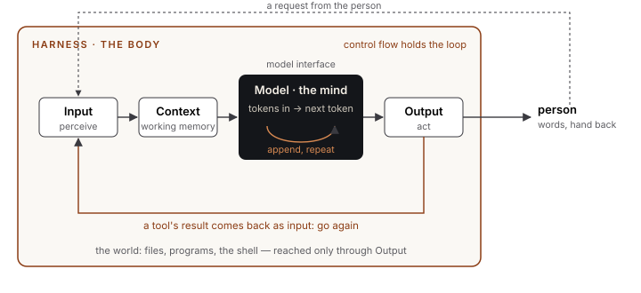
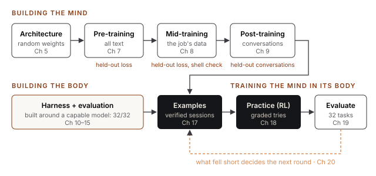

## 3. Mind and Body

Every language agent being built today, however complicated, is made of two parts.

The **model** is the mind. It does one thing: it takes text in and outputs the next piece of text. That's all. It decides, in the sense that what it writes is its choice of what to say or do next. But it can't see anything it isn't handed, it can't remember anything between one use and the next, and nothing it writes happens in the world. It can write the words of a command, and the command doesn't run.

The **harness** is the body. It's everything around the model: it takes in what's happening, gathers what the model needs to see, hands it over, carries out what the model decides, and sends the results back around. It turns the model's words into actions, and what happened back into words.

> **Agent = Harness(Model)**

Neither works alone. A model without a harness is an engine on a workbench: it turns, but goes nowhere. A harness without a model is a car with no engine: everything is in place, and nothing decides where to go.

### The architecture



*Figure 3.1. The agent. The harness's five parts, with the model at the centre; the model runs its own inner loop, one token at a time.*

Read it left to right. Something comes in (a person's request, or the result of an action). The harness assembles a context around it. The context goes to the model, which runs its own small loop: predict a token, append it, predict the next, until it decides to stop. The finished text comes out. If it's words for the person, they're shown. If it's a request to act, the harness acts, and the result loops back to the start as new input.

### What researchers call it

In 2023, researchers at Princeton published [*Cognitive Architectures for Language Agents*](https://arxiv.org/abs/2309.02427), or **CoALA** (Sumers, Yao, Narasimhan and Griffiths). It noticed that people building language agents were reinventing, one project at a time, ideas cognitive science had worked out decades earlier, and gave them a common map. A language agent, in CoALA's terms, has:

- **Memory:** a *working memory* for what's in mind now, and long-term memories that are *episodic* (what happened), *semantic* (what's true, about the world and itself) and *procedural* (how to do things). Procedural memory lives in two places: in the model's trained weights, and in the agent's own code.
- **Actions:** *external* ones, which reach into the world (running a command, speaking to a person); and *internal* ones, which work on its own memory: *retrieval* (bringing something from long-term memory into working memory), *reasoning* (thinking in working memory) and *learning* (writing to long-term memory).
- **A decision cycle:** propose what to do, evaluate the options, select one, execute it, observe, and go again.

CoALA also makes an observation this book leans on: a language model can be seen as a *probabilistic production system*. A production system is a set of rules that rewrite strings. A language model rewrites strings too, by appending to them, except that its rules are learned and its choices are sampled. That's why the same architectures that organized rule-based agents in the 1980s organize language agents now.

### The five parts of every harness

However it's built, every harness does the same five jobs:

| Part | What it does | In cognitive science | CoALA |
|---|---|---|---|
| **Input** | Takes in what comes from outside: a request, or the result of an action | Perceiving | Observation |
| **Context** | Assembles what the model needs to see: instructions, the conversation, memories | Working and long-term memory | Working memory, retrieval |
| **Model interface** | Sends that to the model, and brings back its response | The link between deciding and the rest | Reasoning |
| **Output** | Handles the response: shows its words, or carries it out as an action | Acting | Grounding actions |
| **Control flow** | Decides what happens next: go again, hand back, or stop | The cycle | The decision cycle |

Here is the pseudocode from Chapter 1 again, with the five parts named. This is the whole harness; Part III fills each line in.

```
procedure CONTROL_FLOW:
    conversation ← []
    loop:                                        -- outer loop: one request at a time
        conversation.append(INPUT.from_person())
        loop:                                    -- inner loop: one request, carried through
            ctx      ← CONTEXT.assemble(conversation)
            response ← MODEL_INTERFACE.request(ctx)
            conversation.append(response)
            results  ← OUTPUT.handle(response)    -- show words; run tool calls
            if results is empty: break           -- nothing ran: hand back to the person
            conversation.append(INPUT.from_world(results))
```

### How the labs build agents

The labs that make the most capable agents build both parts themselves, in this order:

1. **They build the model,** designing its architecture (Chapter 5).
2. **They pre-train it** on trillions of tokens, so it learns language and how the world works (Chapter 7).
3. **They mid-train it** on chosen material, so it gets good at what matters for its job (Chapter 8).
4. **They post-train it** so it behaves usefully: taking turns, following requests, stopping when done (Chapter 9).
5. **They build the harness** the agent will live in (Chapters 10 to 15).
6. **They train the model in its harness,** with examples of the agent at work and with practice, so the mind learns to use the body it actually has (Chapters 16 to 18).
7. **They check every stage** on material it never trained on, and evaluate the finished agent, in its harness, on held-out tasks of the kind it will do (Chapters 15 and 19).



*Figure 3.2. The path this book follows: build and train the mind, build and prove the body, then train the mind in its body, round after round.*

Then they ship the model and the harness together, and whatever the evaluations found becomes the plan for the next round (Chapter 20).

This book follows those steps, in that order, with one adjustment: the harness is built around a borrowed, capable model before our own model is ready, because a harness is easier to understand when the mind inside it is good enough not to hide what each part does. Chapter 10 explains the choice.
