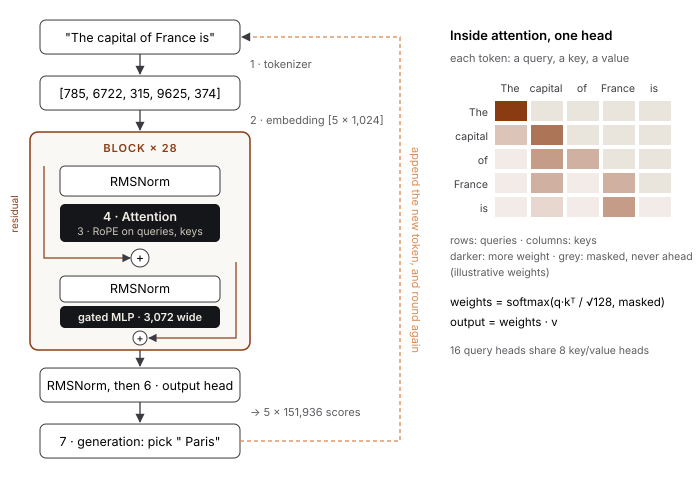

## 5. The Seven Parts of a Model

Every model of this kind, from the smallest to the largest in the world, is built from the same seven parts. Model families differ in the details of each one, but not in what the parts are.

| Part | What it does | In `model.py` |
|---|---|---|
| **Tokenizer** | Turns text into tokens, and back | `class Tokenizer` |
| **Embedding** | Turns each token into a vector that stands for its meaning | `nn.Embedding` |
| **Position** | Marks where each token is | `rotary`, `rotate` |
| **Attention** | Lets each token take in the ones before it | `class Attention` |
| **Block** | Attention, then a small network; stacked many times | `class Block` |
| **Output head** | Gives a score to every possible next token | `x @ embed_tokens.weight.T` |
| **Generation** | Picks the next token, appends it, and goes again | `generate`, `Release.pick` |

We build Qwen3's version of each, so that once ours is built, we can load the weights Qwen trained into it and check that our model does exactly what theirs does. The whole thing is in [`model/model.py`](../model/model.py). The architecture is a **transformer**, the design behind every major language model since 2017; this chapter is a tour of one.

### The shape of the data

Before the parts, the shapes. A batch of text is a tensor (an array) of token ids, shaped `[batch, length]`. The embedding turns it into `[batch, length, dim]`, where `dim` is the model's width, 1,024 for Qwen3-0.6B. Every block takes and returns that shape. The output head turns it into `[batch, length, vocab]`, one score per token in the vocabulary, at every position.

```
ids            [B, L]            integers
   │ embedding
   ▼
x              [B, L, 1024]      one vector per token
   │ block × 28  (shape unchanged)
   ▼
x              [B, L, 1024]
   │ norm, then output head
   ▼
scores         [B, L, 151936]    one score per vocabulary entry, per position
```

The model's sizes, from Qwen's `config.json`:

| Setting | Value | Meaning |
|---|---|---|
| `vocab` | 151,936 | Rows in the embedding table (the tokenizer uses 151,669; the rest is padding) |
| `dim` | 1,024 | Width of every token's vector |
| `layers` | 28 | Number of blocks, stacked |
| `heads` | 16 | Attention heads per block |
| `kv_heads` | 8 | Key/value heads: two query heads share each |
| `head_dim` | 128 | Width of each head |
| `hidden` | 3,072 | Width inside the block's network |
| `theta` | 1,000,000 | Base for the position encoding |



*Figure 5.1. One prediction through the model, numbered by part, with one attention head opened up on the right.*

### 1. Tokenizer

A model can't read letters, only numbers. The tokenizer decides what the pieces are, by **byte-pair encoding** (BPE). It starts with every byte as its own token, then repeatedly merges the most frequent neighbouring pair into a new token. The learned merges, in order, *are* the tokenizer.

```python
class Tokenizer:
    @classmethod
    def learn(cls, text, size, special=()):
        # Split text into "words" with a regex, and count each word's byte sequence.
        words = collections.Counter(
            "".join(BYTES[b] for b in w.encode()) for w in regex.findall(WORDS, text))
        words = {tuple(w): n for w, n in words.items()}
        merges = []
        while 256 + len(merges) + len(special) < size:
            pairs = collections.Counter()
            for w, n in words.items():
                for pair in zip(w, w[1:]):
                    pairs[pair] += n          # count every neighbouring pair, weighted by word frequency
            if not pairs:
                break
            best = max(pairs, key=pairs.get)  # the commonest pair...
            merges.append(best)               # ...becomes a new token
            words = {cls.merge(w, best): n for w, n in words.items()}
        return cls(merges, special)
```

Three details worth knowing:

- **The `WORDS` regex** pre-splits text so merges never cross a word boundary. It separates contractions (`'s`, `'re`), runs of letters, single digits, punctuation, and whitespace. Qwen's regex is close to GPT-4's, except that it splits numbers into single digits.
- **`BYTES`** maps each of the 256 byte values to a printable character, so a token can be stored as a string even when it holds bytes that aren't valid text on their own (the first byte of a multi-byte character, say).
- **Special tokens** like `<|im_end|>` are never split: `encode` cuts the text at them first, and each becomes exactly one id.

To encode a word, split it into bytes and apply the merges, earliest-learned first, until none applies:

```python
    def word(self, w):
        parts = tuple(BYTES[b] for b in w.encode())
        while len(parts) > 1:
            # the adjacent pair with the lowest merge rank, i.e. learned earliest
            pair = min(zip(parts, parts[1:]), key=lambda p: self.ranks.get(p, float("inf")))
            if pair not in self.ranks:
                break
            parts = self.merge(parts, pair)
        return [self.ids[p] for p in parts]
```

*Shortened from `model/model.py`, where the full version is.*

Common words end up as one token; rare words as several. For pre-training (Chapter 7) we learn a 2,048-token vocabulary from Shakespeare with this code. For the real model we load Qwen's 151,669 merges into the same class, and check that we produce the same ids as Qwen's own tokenizer on a set of tricky strings (mixed scripts, emoji, tabs, Windows line endings): the record in `runs/model/check.txt` says `tokenizer: the same tokens as Qwen's: True`.

### 2. Embedding

Each token id selects a row of a table. The row is the token's vector.

```python
self.embed_tokens = nn.Embedding(vocab, dim)   # a table: 151,936 rows × 1,024 columns
x = self.embed_tokens(ids)                     # [B, L] → [B, L, 1024]
```

At first the rows are random. Training moves them until tokens used in similar ways have similar vectors. The table is also reused at the end, as the output head, so a token's embedding does double duty: it's what the token *means* going in, and what the model compares against coming out. Sharing the table this way (**tied embeddings**) saves 155 million parameters in a model of 600 million.

### 3. Position

Embeddings say what each token is, but not where. *Dog bites man* and *man bites dog* have the same tokens. Attention, as we'll see, sums over positions, so without a position signal it couldn't tell those apart.

Qwen3 uses **rotary position embedding** (RoPE). Each token's query and key vectors (next section) are rotated by an angle that grows with the token's position. The rotation is applied in pairs of dimensions, each pair at a different frequency:

```python
def rotary(length, dim, theta=1_000_000.0, start=0):
    # one frequency per pair of dimensions: fast ones for nearby, slow for far
    frequencies = 1.0 / theta ** (torch.arange(0, dim, 2).float() / dim)
    # angle = position × frequency, for every position and every pair
    angles = torch.outer(torch.arange(start, start + length).float(), frequencies)
    angles = torch.cat([angles, angles], dim=-1)
    return angles.cos(), angles.sin()

def rotate(x, cos, sin):                       # rotate each pair (x[i], x[i+half]) by its angle
    half = x.shape[-1] // 2
    return x * cos + torch.cat([-x[..., half:], x[..., :half]], dim=-1) * sin
```

The useful property: the dot product of a rotated query and a rotated key depends only on the *difference* of their positions. So attention sees relative distance ("three tokens back"), not absolute position, which is why a model trained on short texts can often read longer ones. The `start` argument is for generation: a token generated at position 200 is rotated as position 200, even though it's fed in alone.

### 4. Attention

This is the part that lets a token take in its context. Each token produces three vectors from its own:

- a **query**: what it's looking for;
- a **key**: what it offers to others;
- a **value**: what it carries.

Every token's query is compared with every earlier token's key. Where they match well, the token takes a large share of that earlier token's value; where they don't, little.

```
          keys →      The   capital   of   France   is
queries ↓          ┌─────────────────────────────────┐
  The              │  1.0    —       —      —      — │   each row sums to 1
  capital          │  0.3   0.7      —      —      — │   "—": masked, in the future
  of               │  0.1   0.5     0.4     —      — │
  France           │  0.1   0.4     0.1    0.4     — │
  is               │  0.1   0.2     0.1    0.5    0.1│   "is" attends mostly to "France"
                   └─────────────────────────────────┘
```

(Illustrative weights, not measured ones.) The code:

```python
class Attention(nn.Module):
    def __init__(self, dim, heads, kv_heads, head_dim):
        super().__init__()
        self.heads, self.kv_heads, self.head_dim = heads, kv_heads, head_dim
        self.q_proj = nn.Linear(dim, heads * head_dim, bias=False)     # what each token looks for
        self.k_proj = nn.Linear(dim, kv_heads * head_dim, bias=False)  # what each token offers
        self.v_proj = nn.Linear(dim, kv_heads * head_dim, bias=False)  # what each token carries
        self.o_proj = nn.Linear(heads * head_dim, dim, bias=False)     # mix the heads back together
        self.q_norm, self.k_norm = RMSNorm(head_dim), RMSNorm(head_dim)

    def forward(self, x, cos, sin, cache=None):
        batch, length, _ = x.shape
        # project, then split the width into heads: [B, L, heads, head_dim] → [B, heads, L, head_dim]
        q = self.q_norm(self.q_proj(x).view(batch, length, self.heads, self.head_dim)).transpose(1, 2)
        k = self.k_norm(self.k_proj(x).view(batch, length, self.kv_heads, self.head_dim)).transpose(1, 2)
        v = self.v_proj(x).view(batch, length, self.kv_heads, self.head_dim).transpose(1, 2)
        q, k = rotate(q, cos, sin), rotate(k, cos, sin)   # position goes in here
        if cache is not None:                             # generating: reuse earlier keys and values
            if "k" in cache:
                k, v = torch.cat([cache["k"], k], dim=2), torch.cat([cache["v"], v], dim=2)
            cache["k"], cache["v"] = k, v
        k = k.repeat_interleave(self.heads // self.kv_heads, dim=1)   # 8 kv heads serve 16 query heads
        v = v.repeat_interleave(self.heads // self.kv_heads, dim=1)
        scores = q @ k.transpose(-2, -1) / self.head_dim ** 0.5       # [B, heads, L, L]: query·key
        ahead = torch.ones(length, k.shape[2], dtype=torch.bool).triu(k.shape[2] - length + 1)
        weights = scores.masked_fill(ahead, float("-inf")).softmax(dim=-1)   # never look ahead
        mixed = weights @ v                                            # each token's share of each value
        return self.o_proj(mixed.transpose(1, 2).reshape(batch, length, -1))
```

Line by line, the ideas:

- **`scores = q @ kᵀ / √head_dim`.** A dot product per (query, key) pair. Dividing by the square root of the width keeps the scores from growing with the width, which would make the softmax too sharp.
- **The causal mask.** `ahead` is true wherever the key's position is after the query's. Those scores are set to −∞ before the softmax, so they get probability 0. A token can only look *back*, because when the model writes, the future hasn't been written yet. This single mask is what makes the model a next-token predictor rather than a fill-in-the-blank one.
- **Heads.** The projection is split into 16 independent heads of width 128. Each head computes its own attention pattern, free to look for something different: one might track grammar, another names, another what a pronoun refers to. Their outputs are concatenated and mixed by `o_proj`.
- **Grouped queries.** Qwen3 uses 8 key/value heads for 16 query heads (`repeat_interleave` duplicates each kv head for two queries). Keys and values are what the cache stores during generation, so halving them halves the cache.
- **QK-norm.** `q_norm` and `k_norm` normalize each query and key before the dot product, a Qwen3 detail that keeps training stable.
- **The cache.** During generation, each new token's keys and values are appended to those of earlier tokens, so earlier tokens are never recomputed. This is why generating a token costs about the same whether the context is 10 tokens or 10,000.

### 5. Block

A block is attention followed by a small two-layer network (an **MLP**, or feed-forward network). Each adds to its input rather than replacing it, so nothing is lost on the way through. The adding is called a **residual connection**, and it's what lets 28 blocks be stacked without the signal vanishing.

```python
class Block(nn.Module):
    def forward(self, x, cos, sin, cache=None):
        x = x + self.self_attn(self.input_layernorm(x), cos, sin, cache)   # look back, and add
        h = self.post_attention_layernorm(x)
        gate = self.gate_proj(h)
        return x + self.down_proj(gate * torch.sigmoid(gate) * self.up_proj(h))   # think, and add
```

```
   x ──────────────┬──────────────────────────────────┬────────────► x'
                   │                                  │
                   ▼                                  ▼
              RMSNorm ─► attention ─► (+)        RMSNorm ─► MLP ─► (+)
```

- **RMSNorm** rescales each vector to a steady size before attention and before the MLP. Without it, the numbers drift as they pass through 28 blocks.
- **The MLP** widens from 1,024 to 3,072 (`up_proj`), applies a nonlinearity, and narrows back (`down_proj`). Qwen3 uses a *gated* form: `gate_proj` produces a second 3,072-wide vector, passed through SiLU (`gate × sigmoid(gate)`), and the two are multiplied. The MLP is where most of a model's parameters live, and, as far as anyone can tell, where most of its factual knowledge is stored. Attention moves information between positions; the MLP processes it at each position.

### 6. Output head

After the last block and a final norm, each position's vector is compared with every token's embedding:

```python
x = self.norm(x)
return x @ self.embed_tokens.weight.T          # [B, L, 1024] @ [1024, 151936] → [B, L, 151936]
```

A dot product with every row of the embedding table: the closer the match, the higher the score. The result is the logits of Chapter 4.

### 7. Generation

Generation turns scores into text: pick a token, append it, run again. The reference implementation keeps a key/value cache per layer so each new token costs one forward pass over one token:

```python
@torch.no_grad()
def generate(model, prompt, most=200, stop=("<|endoftext|>",), temperature=0.0):
    ids, caches, out = torch.tensor([encode(prompt)]), [{} for _ in model.layers], []
    scores = model(ids, caches)[:, -1]                  # the whole prompt once; fills the caches
    for _ in range(most):
        if temperature:
            next_id = torch.multinomial(F.softmax(scores / temperature, dim=-1), 1)
        else:
            next_id = scores.argmax(-1, keepdim=True)   # greedy
        out.append(next_id.item())
        text = decode(out)
        for s in stop:
            if s in text:
                return text[:text.index(s)]
        # only the new token goes in; its position is the prompt's length plus how many we've made
        scores = model(next_id, caches, start=ids.shape[1] + len(out) - 1)[:, -1]
    return text
```

The released model's own sampling settings (temperature 0.6, top-k 20, top-p 0.95 for Qwen3) are applied by `Release.pick`, which implements all four picking rules from Chapter 4:

```python
def pick(self, scores, temperature=None, top_k=None, top_p=None):
    scores = scores.clone()
    scores[:, self.tokens:] = float("-inf")       # the padding rows of the output head are never tokens
    if temperature == 0:
        return scores.argmax(-1, keepdim=True)    # greedy: repeatable, for evaluation
    scores = scores / temperature                 # sharpen (<1) or flatten (>1)
    if top_k:                                     # keep only the k likeliest
        scores = scores.masked_fill(scores < scores.topk(top_k).values[:, -1:], float("-inf"))
    ordered, order = F.softmax(scores, dim=-1).sort(descending=True)
    ordered[ordered.cumsum(-1) - ordered >= top_p] = 0   # and only as many as make up top_p
    return order.gather(-1, torch.multinomial(ordered, 1))   # draw one
```

### Everything a model ships with

A model is more than its weights. Qwen releases five files, and our `Release` class loads each from its own file and checks it:

| File | What it holds | Why it matters |
|---|---|---|
| `config.json` | The sizes in the table above | Build the right shape before loading weights |
| `model.safetensors` | The weights | 600 million numbers |
| `tokenizer.json` | The merges and vocabulary | Different merges mean different tokens: the weights would be meaningless |
| `tokenizer_config.json` | The **chat template** | How a conversation is laid out as text (Chapter 9) |
| `generation_config.json` | Temperature, top-k, top-p, stop tokens | The sampling the model was tuned for |

Miss one, or get one subtly wrong, and the model breaks *quietly*: it still writes, just worse, and nothing tells you why. Chapter 20 has a story of exactly that.

### Checking it

That's the whole model: about 180 lines, not counting the tokenizer and the loader. Built from nothing, it's an empty shape: random weights, and it writes noise.

To know it's built right, we load Qwen's weights into our code and compare it with Qwen's own implementation (via the `transformers` library) on the same input. The record:

```
tokenizer: the same tokens as Qwen's: True
chat template: the same text as Qwen's: True
model: largest difference in its scores 1.4e-04; the same next token at all 198 positions: True
'The capital of France is' → ' Paris. The capital of Germany is Berlin. The capital of'
```

Scores agree to one part in ten thousand (floating-point order-of-operations noise), and the predicted next token agrees at every one of 198 positions. We have a mind, and we know it's built right. It knows nothing yet. The next chapter is about how a model learns.
